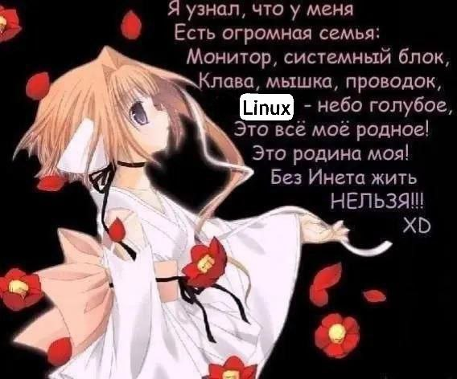

Stack:
- Python, C++
- ML / DL: PyTorch, NumPy, Pandas, Scikit-learn
- Linux, Bash
- Tools: VS Code, Jupyter Notebook,a bit VIM

Interests:
- Large Language Models (LLM)
- Machine Learning & Deep Learning
- Neural Networks
- LLM Agents
- Reverse Engineering
- Linux & Systems Programming

